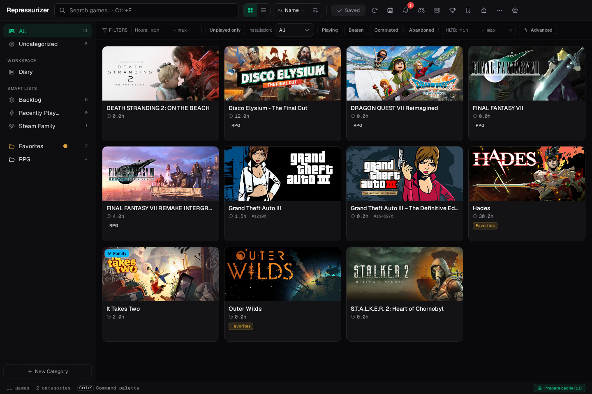

# User guide

The user guide follows the main jobs inside Repressurizer:

- [Edit Steam collections](collections.md) with previews and backups.
- Use [search and structured filters](search-and-filters.md) across large libraries.
- Rank unfinished games with [What to play next](what-to-play-next.md).
- Use the [Session Planner, Tonight Queue, storage, sync, and maintenance tools](planning-and-maintenance.md), including Pack My Deck, Community Rule Packs, and Metadata Health.
- Keep game notes and scoped Markdown pages in the [Diary](diary.md) workspace.
- Compare your library with Achievements, Wishlist, Friends, and Stats from the
  toolbar; each view uses the local cache and the selected Steam account.
- Prepare [metadata and network caches](../cache-and-network.md).
- Generate collections with [AutoCat](autocat.md).
- [Export](export.md) filtered lists and stable snapshots.
- Maintain [backups](backups.md) and configure optional [Integrations](steam-tools.md).

