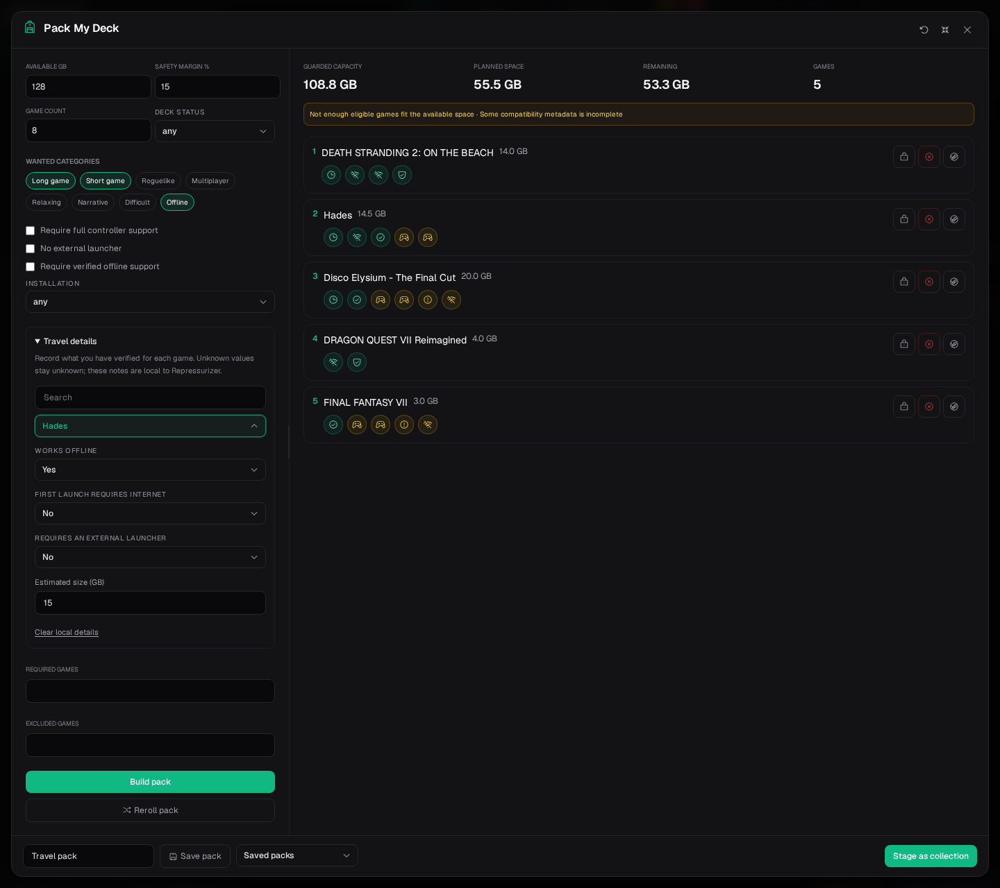
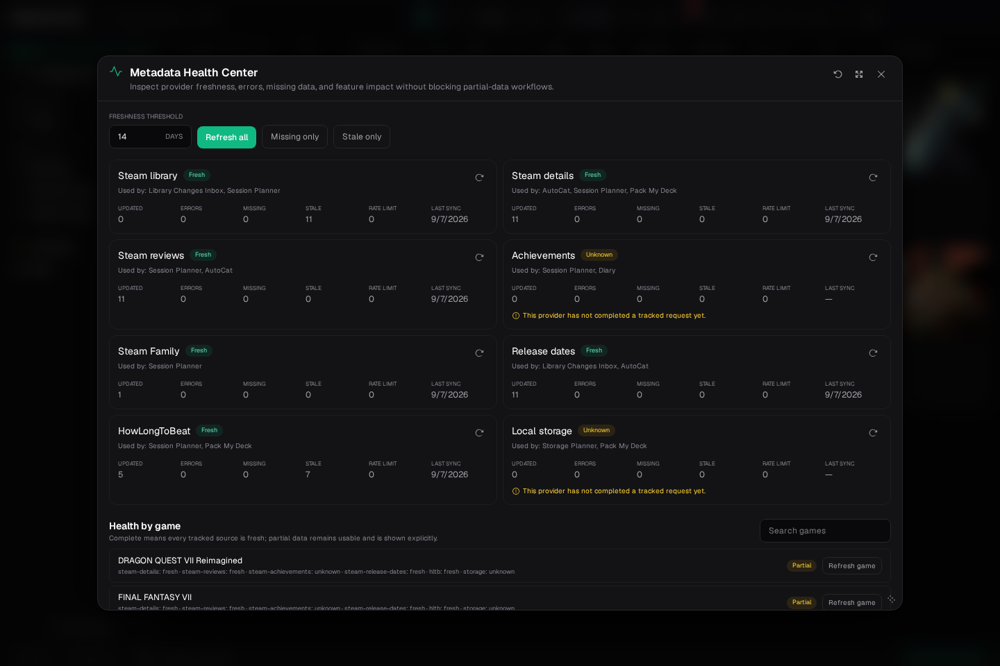

# Plan sessions and maintain your library

Repressurizer adds a set of local, explainable tools for deciding what to play,
reviewing changes, moving data between devices, and planning storage. They use
cached data where possible and keep missing or stale values visible. The tools
are independent: opening a planner or a preview does not write Steam files.

## Session Planner and Tonight Queue

Open **Session Planner** to combine time, device, input, game mode, session
intent, installation state, Family availability, metadata, Diary status, and
achievement progress. Mark a condition as a requirement to exclude games that
do not satisfy it; preferences only affect the visible score.

The planner returns a best fit, a shorter alternative, and a deliberately
different option. Each result lists satisfied requirements, score inputs, and
missing or stale data. Rerolls are seeded and avoid immediately repeating the
same games. You can suppress or tune individual games, pin a primary choice,
save presets, and launch a selected game through Steam.

**Tonight Queue** is temporary and never edits Steam collections while you
reorder it. Add unique games manually or from the planner, drag them into order,
assign a duration, and use start, skip, complete, defer, or remove. Repressurizer
does not launch the next game automatically. Recent queues can be resumed or
converted into a local preset, saved list, or staged collection.

## Library Changes Inbox

The Inbox records meaningful changes only after a successful source refresh.
It covers library and installation changes, Family availability, missing or
stale metadata, provider errors, AutoCat proposals, Diary inconsistencies,
external collection edits, and HLTB drift.

Events have stable IDs and are deduplicated. A temporary provider failure is
recorded as an error and is never interpreted as a removed game. Review,
accept, ignore, or snooze individual events, or inspect a bulk preview first.
Actions that change Diary data are recorded and reversible.

The Inbox is a review surface, not an automatic cleanup job. It is populated
after a successful refresh and does not turn a failed network request into a
deletion. Use the source and provider details on an event to decide whether to
apply it.

## Time Machine and conflict resolution

Collection Time Machine records deduplicated before/after snapshots with the
Steam account, device, source, and membership totals. The timeline can compare
snapshots, export them, pin important recovery points, and prepare full or
selective restores. A verified backup and final preview are required before a
restore reaches Steam.

When current Steam data and a Repressurizer proposal both changed after their
shared base, the three-way resolver compares stable collection IDs. It detects
name, color, creation, deletion, membership, metadata, and order conflicts.
Choose Steam, Repressurizer, union, or a manual result per conflict, apply a
bulk policy where safe, and inspect the merged preview before writing. File
timestamps do not decide the result.

## Profiles and folder sync

A **Repressurizer Profile** can include Diary, Kanban, AutoCat, planner, queue,
preferences, settings, manual collections, and optional history. Export and
import are selective and show a section diff. Imports verify the schema and
checksum and create local and Steam backups before applying relevant sections.

Profiles intentionally omit credentials, API keys, heavy caches, and machine-
specific absolute paths. Saved profiles can be named, renamed, duplicated, and
associated with a Steam account.

Folder sync works with a local folder or one managed by a network share,
Syncthing, Dropbox, OneDrive, Google Drive, iCloud Drive, or similar software.
It exchanges versioned Repressurizer profiles and entity journals, never active
Steam files. Writes use a temporary file, read-back verification, and atomic
rename. Concurrent edits are merged against a shared base; unresolved fields
remain selectable as local, remote, or base. Automatic sync can be paused and a
working local copy remains available offline.

## Storage Planner

Storage Planner scans every detected Steam library and measures installed game
directories plus Workshop, shader cache, and Proton compatdata. It reports the
scan time, drive capacity, and free space. Set a fixed-space or percentage goal,
protect games permanently or for 30 days, then simulate an explainable reclaim
list based on completion, play history, and actual local size.

Repressurizer never deletes game folders or performs a batch uninstall. The
result can be exported and each item opens Steam's own game details screen.
Warnings call out shared files, launchers, pending updates, and unknown local-
save sync state where those facts cannot be verified safely.

## Pack My Deck

Pack My Deck builds a deterministic, diverse travel set within an available-
space budget and safety margin. Configure target count and categories, require
known controller/offline/launcher/Deck properties, lock mandatory games, and
exclude unwanted ones. Each result shows size, priority, reasons, limitations,
and the remaining capacity. Packs can be rerolled, saved, staged as collections,
or used as a prioritized Steam install plan.

Actual local sizes take precedence. An estimate is used only when explicitly
available. Steam StoreBrowse can provide a Deck compatibility category,
which Repressurizer maps to **Verified**, **Playable**, or **Unsupported**;
missing or failed enrichment remains **Unknown**. Popular Steam community tags are
also available after the bounded Store enrichment request.

Steam does not expose reliable authoritative values for external-launcher
behavior, offline support, first-launch requirements, or install size through
the endpoints Repressurizer uses. Those fields remain **Unknown** unless you
enter a local value in the Pack My Deck metadata editor. A manually entered
value is stored in local app data (`travel_metadata.json`) and never changes
Steam. These travel notes are not currently included in portable profile exports. Installed sizes discovered by the Storage Planner take
precedence over estimates.

Screenshots show an example library and local travel notes, not verified
compatibility claims for the pictured games.

## Community Rule Packs and metadata health

Community Rule Packs contain declarative Custom AutoCat rules only. Search the
built-in gallery or import a JSON file, review match counts and destination
collections, then install the rules as disabled or editable local presets.
Installing a pack never applies collection changes. Updates preserve detached
or locally modified rules and keep a previous version for rollback.

The Metadata Health Center summarizes every provider and game as complete,
partial, stale, missing, unavailable, private, rate-limited, or failed. It shows
dependent features and supports full, missing-only, stale-only, provider-only,
and game-only refreshes. Cache and exponential backoff prevent one unavailable
provider from blocking unrelated features.

## Choosing a region for planner prices

Price conditions and library value use the Store country selected in Settings.
The planner never converts prices between currencies and never assumes that two
countries sharing a currency have the same Store price. If a country has no
price for a game, the value is shown as unavailable and the planner reports the
missing data instead of ranking on a guessed amount.
